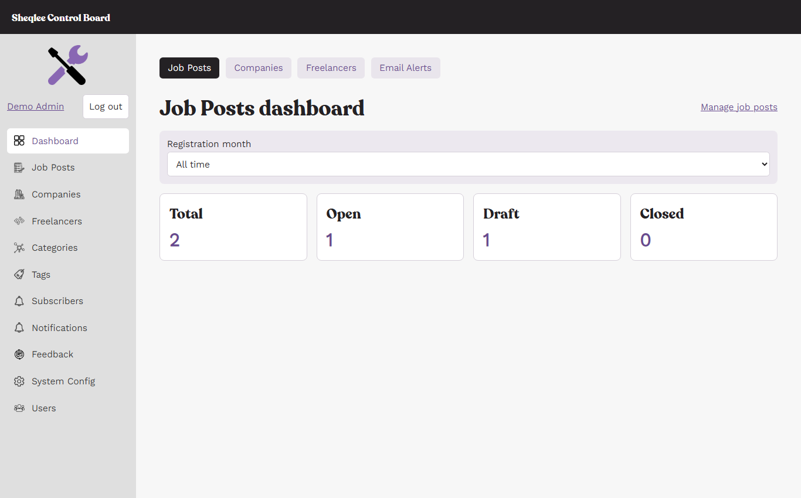
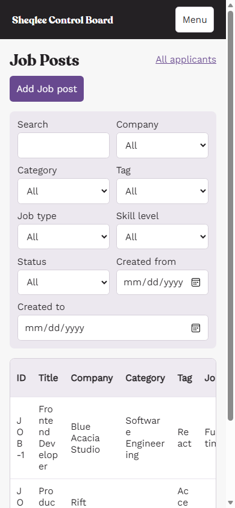

# Sheqlee Control Board

Sheqlee is a frontend-only job management demo. The original project was uploaded on February 27, 2025, and subsequently restored and enhanced. The restoration retains the Create React App toolchain and the control board's fonts, icons, and colors.

## Features

- Manage job posts and their applicants, companies, freelancers, categories, tags, and demo users.
- Manage subscribers, feedback, notifications, FAQs, About and policy pages, testimonials, hero content, and footer sections.
- Search, filter by available fields and creation date, sort columns, and paginate collections. Forms validate data, deletion requires confirmation, and related records are protected from orphaning.
- Edit or reset demo profile contact details. Dashboard totals are calculated from stored records and can be filtered by month.
- Use the collapsible sidebar and independently scrollable tables on small screens.

## Screenshots





## Install and run

The project uses React 18, React Router 7, Create React App 5, react-app-rewired, customize-cra, and CSS. Use Node.js 22 or later with npm.

```sh
npm ci
npm start
npm test -- --watchAll=false --runInBand
npm run build
```

Open http://localhost:3000. For static hosting, serve the contents of `build/` and configure the host to serve `index.html` for application routes.

## Demo accounts

All three fictional accounts start with the password `password123`.

| Email | Role | Access |
| --- | --- | --- |
| `owner@example.com` | Super Admin | Manage all collections, including users |
| `admin@example.com` | Admin | Manage operational collections and view users |
| `viewer@example.com` | User | View operational collections and manage own profile |

Activation and password reset use the built-in code `272025`. Password changes live in memory and last until reload. Newly created user records describe demo users. Sign-in is available for the three built-in accounts.

Client-side authentication and authorization are insecure and intended only for demonstration. The session stores a demo account ID in `sessionStorage`. Use fictional records only. Do not enter real credentials, applicant contact details, confidential data, or production tokens.

## Architecture and storage

- `src/routes` defines public and protected routes, tabs, and legacy route redirects.
- `src/features` contains collection, dashboard, profile, and sign-in screens.
- `src/components` contains the control board shell and reusable record form.
- `src/constants/modules.js` defines each collection's fields, types, and relationships.
- `src/services` exposes per-module record operations and isolates browser storage and demo authentication.
- `src/hooks` loads collection data and refreshes on storage events. `src/utils` handles validation and querying. `src/data` supplies fictional seed records.

Each collection uses a separate `sheqlee.v1.*` localStorage key and is seeded only if its key is missing. Existing empty collections stay empty. Records have stable IDs and creation and modification timestamps. Invalid storage is reported in the affected view. Reads preserve the stored contents, and a subsequent write can repair a collection while retaining valid rows.

## Known limitations

Storage is specific to the browser and origin. There is no multi-user synchronization, backup service, atomic cross-tab write coordination, email delivery, or secure login. Notifications and content settings are managed locally. The dashboard derives statistics from current records and does not store historical snapshots. The older profile photo upload and CV links are omitted in this fictional-data demo. Dashboard summary cards represent stored records, so the original hardcoded totals and trends are gone.

The CRA toolchain can emit notices about stale browser data, Babel's undeclared private-property plugin, and deprecated development-server middleware. The React Testing Library version can emit a React `act` deprecation notice. Keep the lockfile and rerun tests, builds, and npm audit after compatible dependency updates. Refresh Browserslist data or explicitly declare the compatible Babel plugin if toolchain maintenance requires it.

## Future Django REST Framework and PostgreSQL integration

Map collections and their relationships to PostgreSQL models with foreign keys and unique constraints. Replace the browser-backed services with a Django REST Framework client and make the data hook handle asynchronous loading, pagination, conflicts, and errors. Move validation, password recovery, and permissions to the server, and calculate dashboard aggregates and deliver notifications through backend endpoints.
